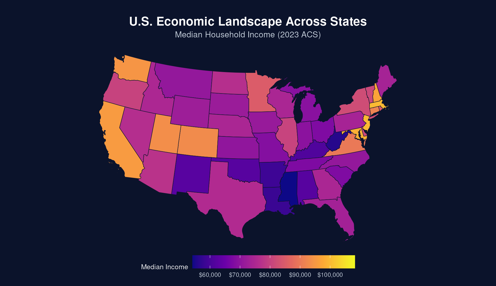

## Exploring how population and prosperity change together

This website uses data from the U.S. Census Bureau to explore population growth and economic development across the United States.

### Questions we will explore

- Which states have grown fastest?
- How do states differ in median household income?
- How might population change be related to economic opportunity?

Visit the **Analysis** page to see charts based on American Community Survey data.
